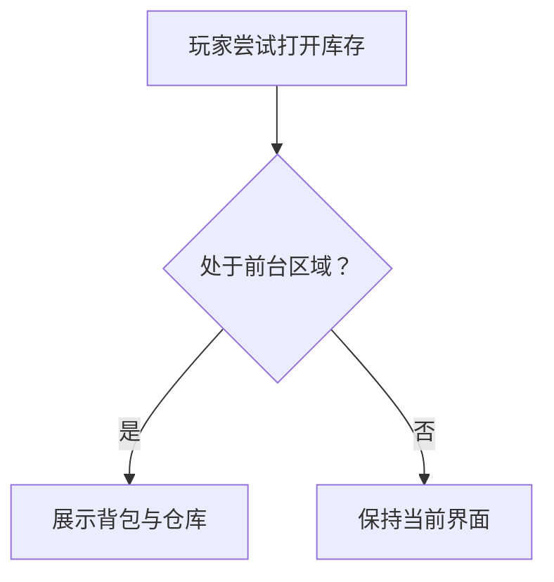

# 游戏功能设计文档

先读 Vault 的 `AGENTS.md`、目标版本和关联设计。用已有功能 Key 找到责任文档。更新该页负责的规则，其他文档用双链引用。功能入口页负责讲清上下级、共享流程和各子功能的去向。

## 功能页结构

| 章节 | 写什么 |
| --- | --- |
| 功能定位 | 一句话说明谁在何时用它做什么。列出所属上级功能、它依赖的能力、它提供给哪些下游，以及当前版本的范围。每条依赖写明使用了对方什么能力。 |
| 操作逻辑 | 按玩家视角写入口、前置条件、操作、即时反馈和退出方式。纯后台系统改写为触发事件、输入、输出和被谁消费。 |
| 系统规则 | 按条件和结果写可执行的规则。说明状态如何变、结果写到哪里，以及取消、失败、边界和重试行为。数值和公式放在负责它们的章节。 |
| 流程图 | 页面内嵌 Mermaid `flowchart TD`。从实际入口开始，标出已确定的判断条件、结果、失败反馈和返回路径。系统规则与图中的分支逐条对应。 |
| 验收与待决策 | 用「给定条件／执行动作／预期结果」列主路径和关键边界。每个未定项写清要决定的问题和影响范围。 |

主文按功能和决策组织。聊天记录、调研过程和旧方案放在默认折叠的 Obsidian callout 或链接附录中。索引页使用「子功能／职责／依赖／入口」表，流程图放在实际负责该流程的功能页。工程接口和派工链接到开发文档。

## 示例结构

以柜台打开库存为例。已知规则放主流程。图中的条件和反馈仍需依据原始需求或已批准规则核实。

该页链接「地图网格与前台区域」，注明依赖它提供前台判定。链接「格子背包与仓库」，注明库存容量和摆放由该页定义。

## 修订与交付

1. 先把原文中的已确认规则、旧规则、待确认项和背景证据逐条归位。保留已有数值、条件、适用版本和来源。新旧说法冲突时标出冲突与来源，等待决策。
2. 检查读者能否从定位找到入口，从操作找到系统结果，并在流程图里走通主要和失败路径。核对双链及验收是否覆盖这些路径。
3. 按 Vault 约定填写审核属性和来源。FarpostInn 中修改设计文档后设置 `einzig_status: needs_review`。从待整理输入落地时，把相关设计与 Agent 开发文档一起列入原输入的 `NeedReviewList`。
